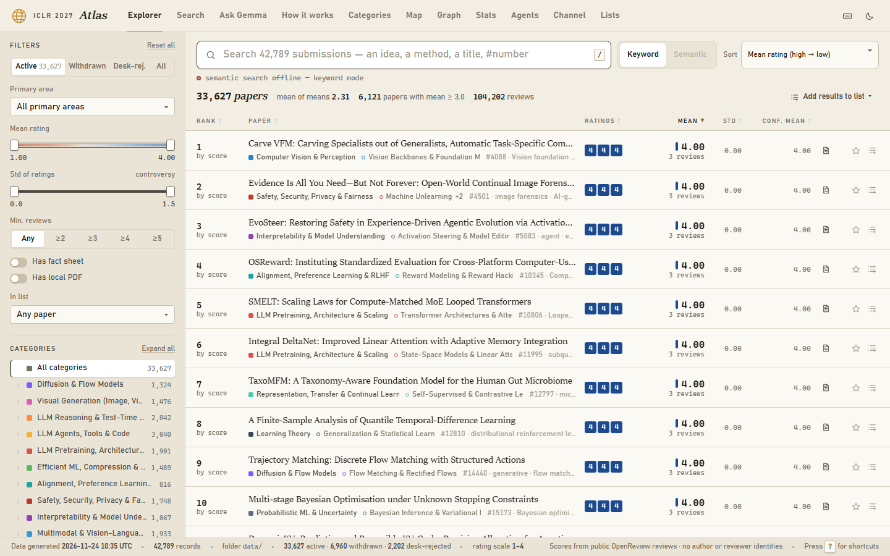
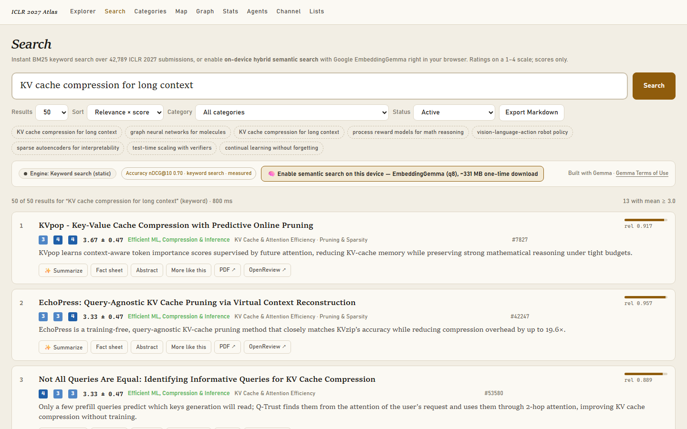
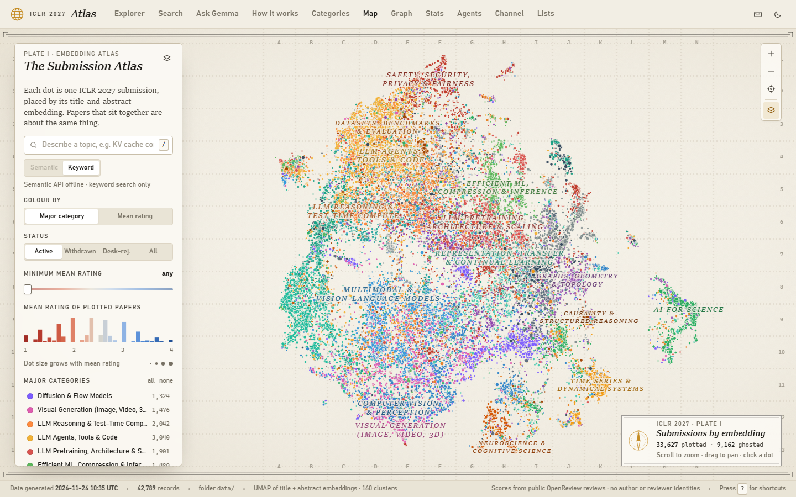
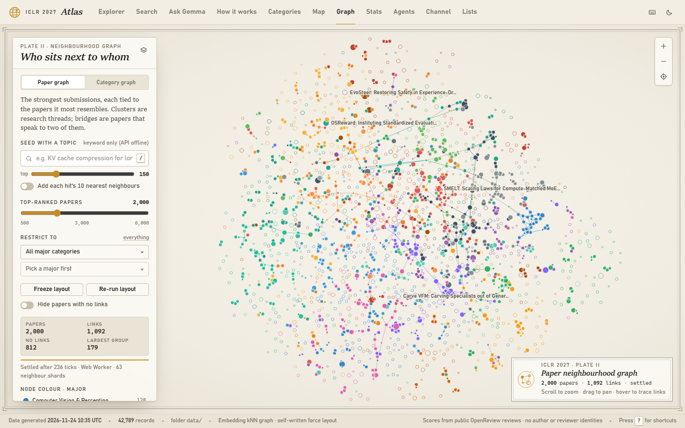
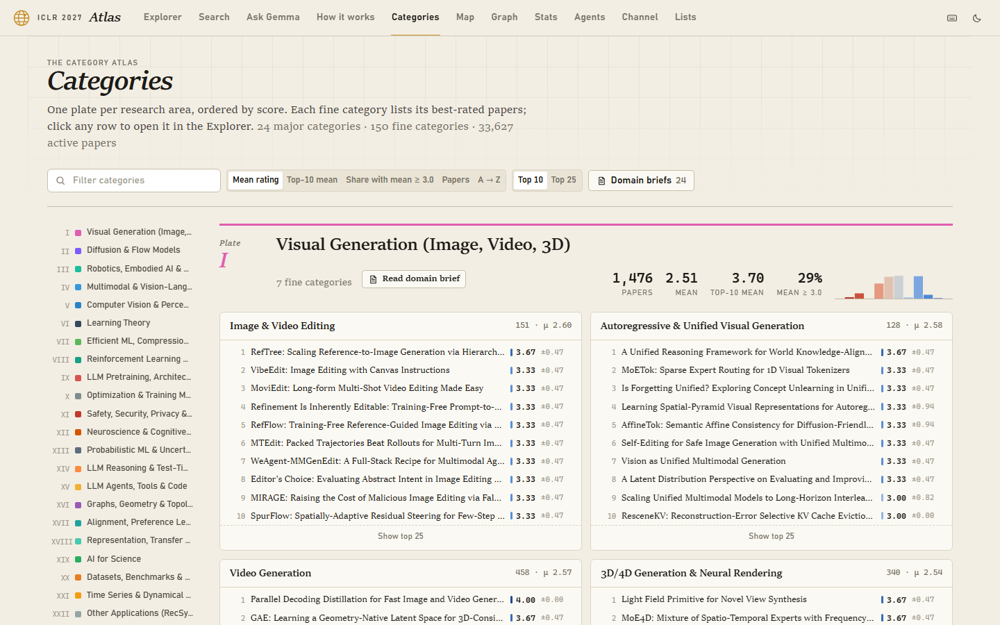
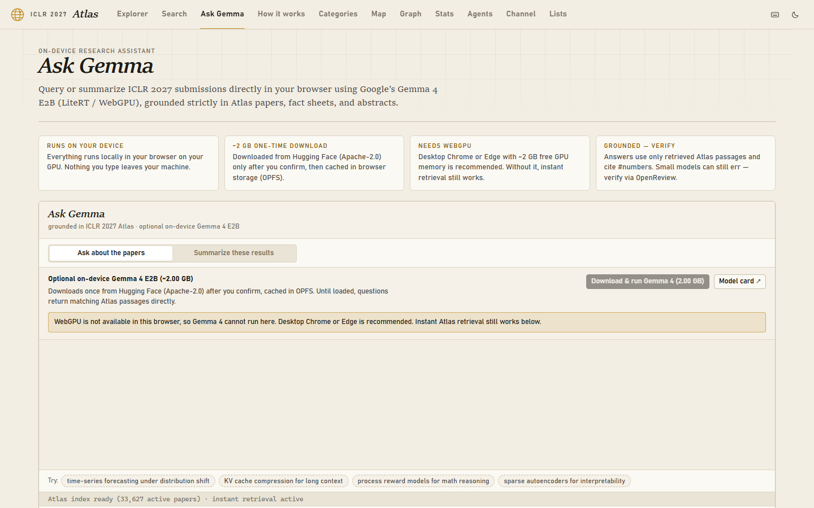
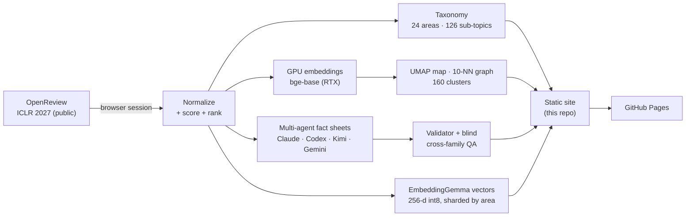
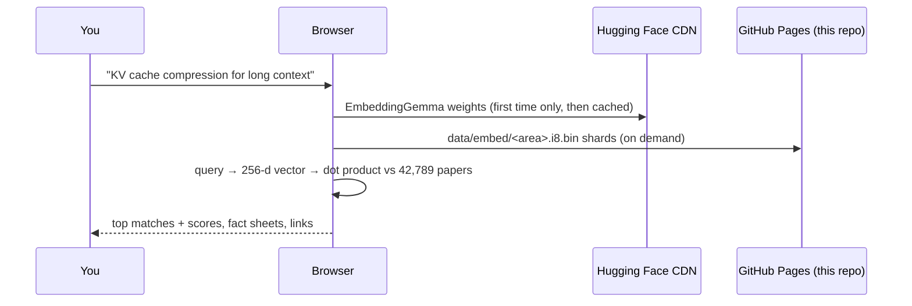

<div align="center">

# 🗺️ ICLR 2027 Atlas

### A browsable, searchable map of every ICLR 2027 submission — ranked, categorized, summarized.

**[🌐 Open the Atlas](https://optimizer077.github.io/iclr2027-atlas-site/)** ·
[🔎 Search](https://optimizer077.github.io/iclr2027-atlas-site/search.html) ·
[🗺️ Map](https://optimizer077.github.io/iclr2027-atlas-site/map.html) ·
[🕸️ Graph](https://optimizer077.github.io/iclr2027-atlas-site/graph.html) ·
[💬 Ask Gemma](https://optimizer077.github.io/iclr2027-atlas-site/ask.html) ·
[⚙️ How it works](https://optimizer077.github.io/iclr2027-atlas-site/how.html)


-5b6b7f?style=flat-square)



</div>

> [!IMPORTANT]
> **Scores are preliminary.** They are reviewer ratings (1–4 scale) collected from public OpenReview pages during the review period (24 Nov 2026) and change during discussion. The Atlas shows scores only — it makes **no prediction of acceptance**; decisions belong to the program committee. Fact sheets, briefs and summaries are written by AI agents — validated and spot-audited, but verify against the paper before citing. Not affiliated with ICLR or OpenReview.

---

## ✨ What you can do

<table>
<tr>
<td width="50%" valign="top">

### 🔎 Find papers by meaning
Type *"KV cache compression for long context"* and get the papers about that idea — not just the ones that repeat your words. Search runs **in your browser** (EmbeddingGemma) with no server, and falls back to fast keyword search anywhere.</td>
<td width="50%" valign="top">

### 📊 Rank by what reviewers said
Every active submission is ordered by its mean rating (confidence-weighted to break ties), with the individual scores, spread and sub-scores (soundness · presentation · informativeness).

</td>
</tr>
<tr>
<td valign="top">

### 🧾 Read a fact sheet in 20 seconds
The **top 15,000** papers each have a fact sheet: problem · method · *key idea (the mechanism)* · evidence · claimed gains (exact numbers or "not stated") · what reviewers agreed on · the main concern.

</td>
<td valign="top">

### 🗺️ See the whole field at once
An embedding **map** of all 42,789 papers, a **graph** of nearest-neighbour links and of how sub-topics co-occur and **24 domain briefs**.

</td>
</tr>
<tr>
<td valign="top">

### 💬 Ask Gemma — on your device
Ask questions about the papers or *"summarize these results"*. **Gemma 4 E2B** runs locally on WebGPU (LiteRT / MediaPipe); it answers only from retrieved fact sheets and abstracts and cites `#paper` numbers. Nothing is sent anywhere.

</td>
<td valign="top">

### 📚 Keep your own reading lists
Star papers, build named lists with notes, export Markdown / CSV / JSON, or share a list as a link. Everything stays in your browser.

</td>
</tr>
</table>

## 🖼️ Tour

| Explorer | Semantic search |
|---|---|
|  |  |
| **Map** — 42,789 papers, colored by area | **Graph** — a topic's papers and their nearest neighbours |
|  |  |
| **Categories** — 24 areas, leaderboards and AI domain briefs | **Explorer** — filter, sort and open any paper |
|  |  |
| **Ask Gemma** — on-device answers with citations | |
|  | |

## 🔢 The numbers

| | |
|---|---|
| Submissions | **42,789** — 33,627 active · 6,960 withdrawn · 2,202 desk-rejected |
| Review scores | **104,202** reviews · 1–4 rating scale · venue mean of paper means **2.31** |
| Taxonomy | **24** research areas · **126** sub-topics (e.g. *Efficient ML → KV Cache & Attention Efficiency*) |
| Fact sheets | **15,000** (top 15,000 by rank) · 300 batches × 50 · all schema-validated |
| Blind QA | **338** fact sheets audited by a model of the *other* family · mean **4.88 / 5** · **95 %** fully faithful |
| Domain briefs | **24** (one per area) |

## ⚙️ How it works



### 🧪 How the data was processed — step by step

1. **Collect.** All ICLR 2027 records (active, withdrawn, desk-rejected) and their official reviews were read from the public OpenReview venue through a normal logged-in browser session (no scraping around bot protection). Review *scores* are kept; review *text* is used only to write short digests and is not redistributed.
2. **Score.** Per paper: mean rating, standard deviation, mean confidence, a confidence-weighted mean (Σ rating × confidence / Σ confidence) and mean sub-scores. Active papers are ordered by mean rating, ties broken by the confidence-weighted mean, then by number of reviews. No acceptance labels are assigned — decisions are not ours.
3. **Categorize.** A transparent rule-based classifier scores 126 sub-topic pattern sets against title (×3), keywords (×2), TL;DR (×1.5) and abstract (×1), adds the author-chosen ICLR primary area as a prior, and assigns one of 24 areas plus 1–3 sub-topics. Agents audited the result and proposed new sub-topics for the next taxonomy version.
4. **Embed & map.** Title + TL;DR + abstract → **bge-base-en-v1.5** embeddings on a GPU → exact cosine 10-nearest neighbours, 160 KMeans clusters (auto-labelled from distinctive title terms) and a 2-D **UMAP** map.
5. **Fact sheets.** The top 15,000 papers were split into 300 batches of 50. Each batch was written by one agent (Claude Sonnet, Codex, Kimi or a Gemini 4 model) from the title, TL;DR, abstract and trimmed review strengths/weaknesses, following one shared prompt. A validator rejected any batch with missing papers, missing fields or numbers in *claimed gains* that do not occur in the source text; rejected batches were redone.
6. **Audit.** A blind sample (2 per batch, 338 total) was graded field-by-field by a model of the *other* family (faithfulness, mechanism-level key idea, correct numbers, grounded reviewer fields).
7. **Briefs.** Agents wrote one brief per area from its top 60 papers.
8. **In-browser search index.** The same papers are embedded with **EmbeddingGemma** (ONNX), truncated to 256 dimensions (Matryoshka), quantized to int8 and sharded by area into `data/embed/`.

### Two Gemma models, two jobs

| Stage | Model | Job |
|---|---|---|
| **1 · Find** | **EmbeddingGemma 300M** — an *embedding* model (~150–200 MB) | Turns your query into a vector and finds the papers whose vectors are closest → **this is the semantic search** |
| **2 · Read & answer** | **Gemma 4 E2B** — a *language* model (~2 GB, optional) | Reads the fact sheets/abstracts of the papers found in stage 1 and writes an answer or summary that cites `#numbers` |

### 📏 Measured search accuracy

Benchmark: 80 researcher queries (topic, known-item, cross-area) with 2,493 blind-graded results, plus 200 queries that describe a paper's idea **without its title words**. Weights were tuned on half of the queries and are reported on the other half.

| Engine | nDCG@10 (all 80) | MRR@10 | Idea query: target in top-10 | top-1 |
|---|---:|---:|---:|---:|
| bge-base (previous default) | 0.744 | 0.697 | 56 % | 27 % |
| Hybrid (bge + Gemma + BM25) | 0.802 | 0.812 | 80 % | 48 % |
| **Idea fusion (current default)** | **0.813** | **0.835** | **94 %** | **73 %** |

Full tables, latency and side-by-side examples are on the [How it works](how.html#quality) page.

### Three search engines, one search box

| Engine | Where it runs | When it's used |
|---|---|---|
| **Server idea search** — fusion of bge-base + EmbeddingGemma + BM25 + a Qwen3 *idea index* (fact-sheet problem / key idea / method) | The authors' machine (`/api/search`, ~0.1 s) | Only on the live research server, not on GitHub Pages |
| **In-browser semantic** — EmbeddingGemma 300M (ONNX, quantized) | **Your device** (WebGPU, WASM fallback) | After you click *Enable semantic search* — one-time model download, cached |
| **Keyword** — BM25-style term weighting | Your browser | Always available; instant fallback |



### 📦 Where the embeddings live

The document vectors are stored **in this repository** under [`data/embed/`](data/embed) — one int8 shard per research area plus `meta.json` (model, dimensions, scales, paper ids). Your browser fetches only the shards it needs and keeps them in memory; the model weights come from the Hugging Face CDN, never from this repo. The [How it works](https://optimizer077.github.io/iclr2027-atlas-site/how.html) page shows every shard as a box that lights up as it loads, and runs a live, step-by-step search demo with real timings.

## 🤖 Built by a team of AI agents

The Atlas was produced by a multi-agent orchestration coordinated through a shared, file-based channel (with a living rulebook that the agents update as they learn):

| Agent | Role |
|---|---|
| **Claude** (orchestrator) | data pipeline, scoring, taxonomy, GPU jobs, integration, QA design |
| **Claude Sonnet** sub-agents | site pages, visualizations, domain briefs, QA audits |
| **Codex CLI** | fact sheets, domain briefs, explainer page, end-to-end tests |
| **Gemini 4** (Neon · Argon · Hydrogen · Carbon) via Antigravity | fact sheets, blind QA, on-device Gemma integration |
| **Kimi CLI** | fact sheets, domain briefs |

Every fact sheet passed a schema + number-provenance validator; a blind sample was audited by a model from the *other* family. See [`data/channel/qa_report.md`](data/channel/qa_report.md) and the live **Agents** and **Channel** pages (de-identified snapshots).

## 🗂️ Repository layout

```
├── index.html, search.html, categories.html, map.html, graph.html,
│   stats.html, lists.html, ask.html, how.html, channel.html
├── assets/            css · js (vanilla ES modules, no build step)
└── data/
    ├── papers.json    all 42,789 records (scores, order by score, categories, map coords)
    ├── abstracts/     sharded by submission number
    ├── factsheets/    15,000 AI fact sheets
    ├── neighbors/     10 nearest papers per paper
    ├── embed/         EmbeddingGemma vectors, int8, sharded by area
    ├── reports/       24 domain briefs (Markdown)
    └── channel/       de-identified orchestration snapshots
```

## 💻 Run it locally

```bash
git clone https://github.com/Optimizer077/iclr2027-atlas-site
cd iclr2027-atlas-site
python -m http.server 8000      # then open http://localhost:8000
```

No build step, no dependencies. *Ask Gemma* and in-browser semantic search need a WebGPU-capable browser (desktop Chrome / Edge recommended) and download their models from Hugging Face on first use.

## ❓ FAQ

<details><summary><b>Does the Atlas predict acceptance?</b></summary>

No. It only shows preliminary review scores. Final decisions depend on discussion, meta-reviews and the program committee.
</details>

<details><summary><b>Can I trust the fact sheets?</b></summary>

They are grounded in abstracts and public reviews, validated for schema and number provenance, and a blind cross-family audit found 95 % fully faithful (mean 4.88/5). The audit's main caveat: author and auditor families were paired, so the per-model comparison is indicative. Always check the paper.
</details>

<details><summary><b>Why isn't review text included?</b></summary>

Reviews remain on OpenReview. The Atlas only redistributes scores and short AI-written digests (reviewer consensus / main concern).
</details>

<details><summary><b>Does Ask Gemma send my questions anywhere?</b></summary>

No. The model runs entirely on your device after a one-time download that you must confirm.
</details>

## 📜 Licenses & attribution

- Paper titles, abstracts and metadata: © the authors, via [OpenReview](https://openreview.net/group?id=ICLR.cc/2027/Conference) (CC BY 4.0). Reviews are not redistributed.
- **EmbeddingGemma** is provided under and subject to the [Gemma Terms of Use](https://ai.google.dev/gemma/terms). **Gemma 4 E2B** (LiteRT community build) is Apache-2.0.
- Site code and AI-generated summaries in this repository: license to be announced by the author.
- Not affiliated with, endorsed by, or reviewed by ICLR or OpenReview.

<div align="center"><sub>Made with care by a human researcher and a small army of AI agents · data snapshot 24 Nov 2026</sub></div>
